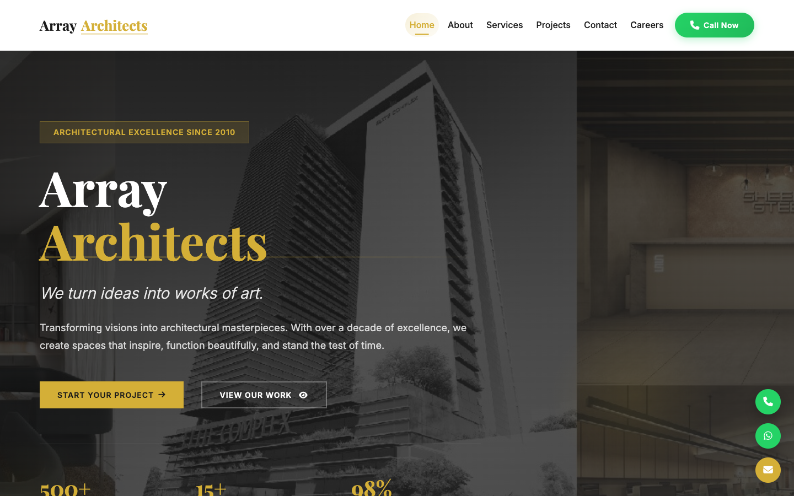
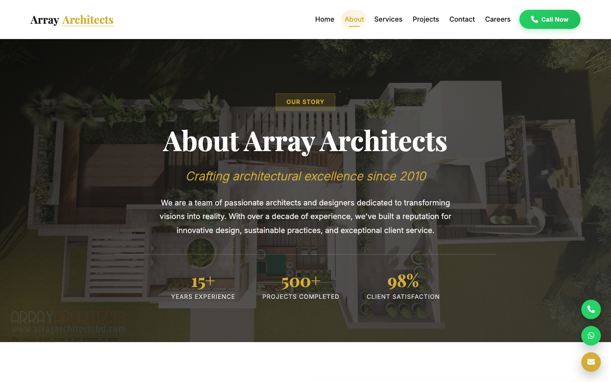
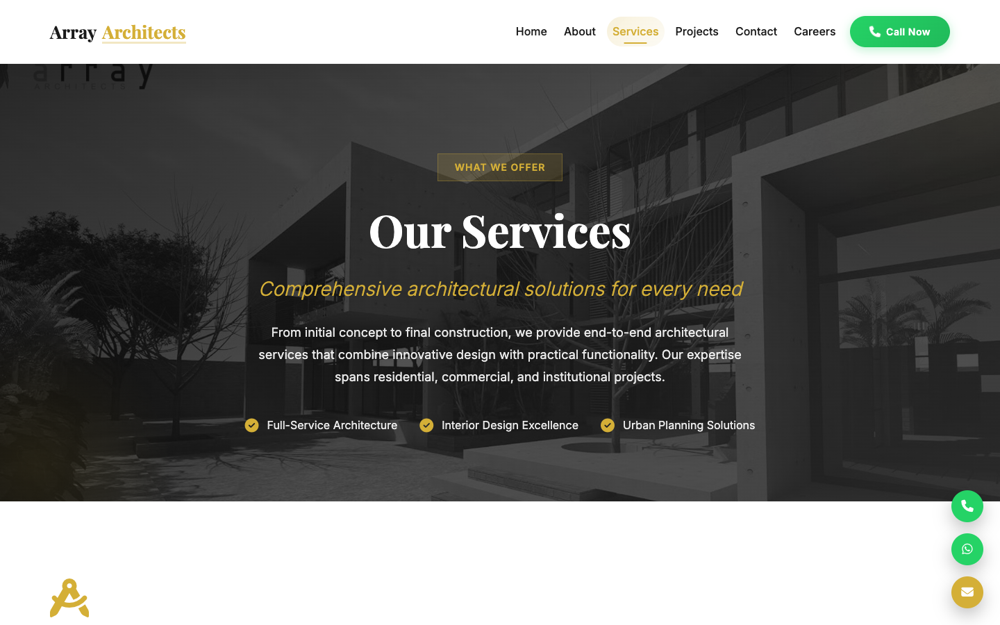
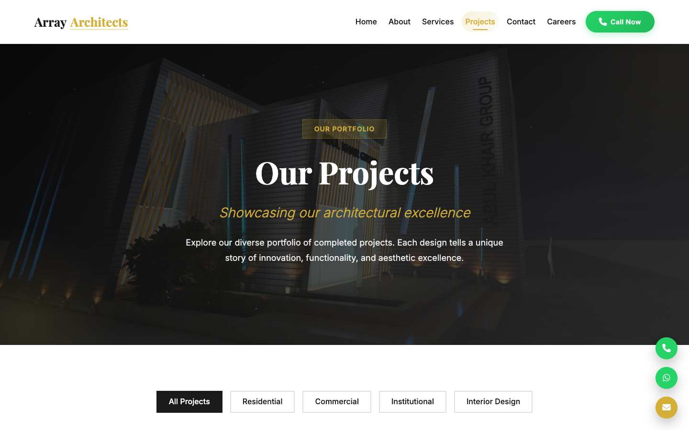
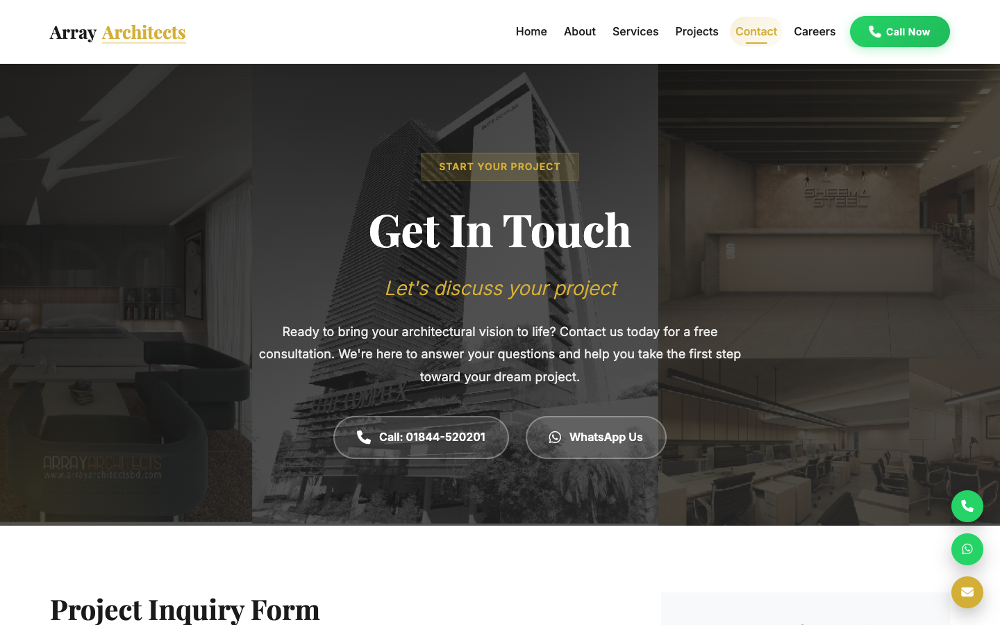
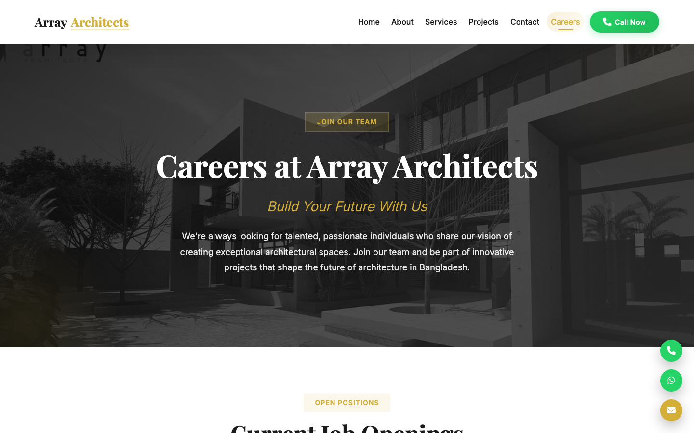
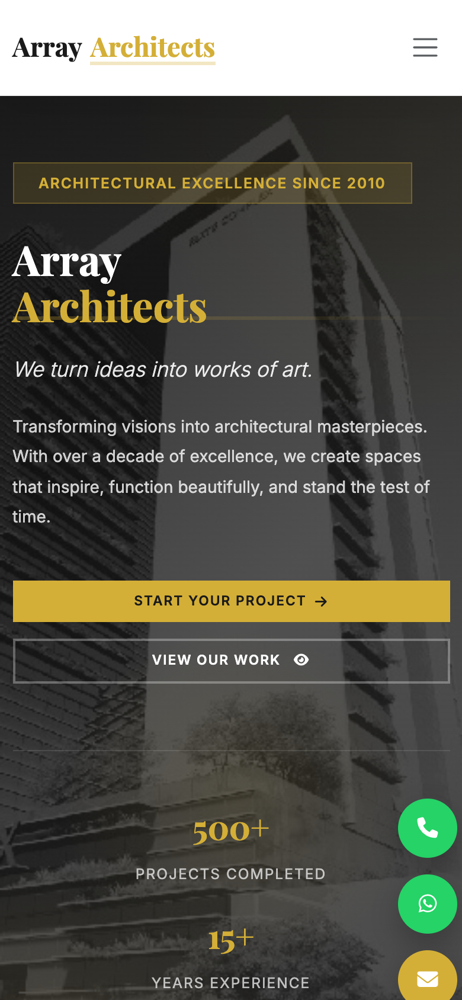
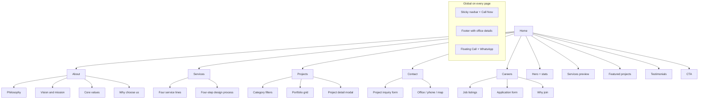

<div align="center">

# Array Architects

**Architecture & Design Studio Website**  
HTML • CSS • Bootstrap 5 • JavaScript

**Live:** [https://array-architects.onrender.com](https://array-architects.onrender.com)

</div>

---

## Project overview

Array Architects is a client-facing website for an architecture studio in Dhaka, Bangladesh. It presents the firm’s services, design philosophy, project portfolio, and hiring pipeline, with direct call and WhatsApp paths so visitors can start a project or apply for a role.

It is a static frontend (no build step) and is suitable for architecture firms, interior studios, urban-planning practices, and similar portfolio sites.

---

## Live demo

| Environment | URL |
| --- | --- |
| Production (Render) | [https://array-architects.onrender.com](https://array-architects.onrender.com) |
| Local (XAMPP) | [http://localhost/2026/array-architects/](http://localhost/2026/array-architects/) |
| Source | [github.com/NahimUdoy/array-architects](https://github.com/NahimUdoy/array-architects) |

---

## Visual overview

Screenshots from the live site, ready to drop into a portfolio, pitch, or GitHub README.

**Desktop (1440×900)**

| Home | About |
| :---: | :---: |
|  |  |
| [Open page](https://array-architects.onrender.com/) | [Open page](https://array-architects.onrender.com/about.html) |

| Services | Projects |
| :---: | :---: |
|  |  |
| [Open page](https://array-architects.onrender.com/services.html) | [Open page](https://array-architects.onrender.com/projects.html) |

| Contact | Careers |
| :---: | :---: |
|  |  |
| [Open page](https://array-architects.onrender.com/contact.html) | [Open page](https://array-architects.onrender.com/careers.html) |

**Mobile (Home)**

<p align="center">
  
</p>

**Full-page captures** (entire scroll, for decks or case studies) live in `assets/screenshots/`:

| File | Page |
| --- | --- |
| `01-home.png` / `01-home-full.png` | Home |
| `02-about.png` / `02-about-full.png` | About |
| `03-services.png` / `03-services-full.png` | Services |
| `04-projects.png` / `04-projects-full.png` | Projects |
| `05-contact.png` / `05-contact-full.png` | Contact |
| `06-careers.png` / `06-careers-full.png` | Careers |
| `07-home-mobile.png` | Home (mobile) |

---

## Site overview



---

## Feature overview

| Feature | Home | About | Services | Projects | Contact | Careers |
| --- | :---: | :---: | :---: | :---: | :---: | :---: |
| Responsive layout (mobile / tablet / desktop) | Yes | Yes | Yes | Yes | Yes | Yes |
| Sticky navbar + active page state | Yes | Yes | Yes | Yes | Yes | Yes |
| Click-to-call (`+880 1844-520201`) | Yes | Yes | Yes | Yes | Yes | Yes |
| WhatsApp chat (`wa.me/8801844520201`) | Yes | Yes | Yes | Yes | Yes | Yes |
| Floating call / WhatsApp buttons | Yes | Yes | Yes | Yes | Yes | Yes |
| SEO meta tags + semantic HTML | Yes | Yes | Yes | Yes | Yes | Yes |
| Page hero with photography | Yes | Yes | Yes | Yes | Yes | Yes |
| Stats / trust numbers | Yes | Yes | — | — | — | — |
| Services showcase | Preview | — | Full | — | — | — |
| Portfolio / project gallery | Preview | — | — | Full + filters + modal | — | — |
| Testimonials | Yes | — | — | — | — | — |
| Vision, mission, values | — | Yes | — | — | — | — |
| Design process steps | — | — | Yes | — | — | — |
| Project inquiry form + validation | — | — | — | — | Yes | — |
| Google Map embed | — | — | — | — | Yes | — |
| Job listings | — | — | — | — | — | Yes |
| Career application form | — | — | — | — | — | Yes |
| CTA to start a project / apply | Yes | Yes | Yes | Yes | Yes | Yes |

### Shared UI

- Sticky header that changes on scroll
- Mobile hamburger menu (Bootstrap collapse)
- Footer with brand, quick links, contact details, and social icons
- Smooth in-page scrolling that accounts for the sticky nav
- Playfair Display + Inter typography, Font Awesome icons

### Home

- Full-screen hero with overlay, badge, tagline, and dual CTAs
- Trust stats (projects completed, years, satisfaction)
- About teaser
- Four service cards with links through to Services
- Featured project cards
- Client testimonials
- Bottom CTA (quote + call)

### About

- Studio story and philosophy
- Vision and mission
- Core values: Excellence, Innovation, Sustainability, Integrity
- Why-choose-us reasons (track record, team, client focus, delivery)

### Services

- Architectural design
- Interior design
- Urban planning
- Project consultation
- Design process: Consultation → Design Development → Documentation → Construction

### Projects

- Filters: All, Residential, Commercial, Institutional, Interior Design
- Eleven portfolio items with hover overlays
- Click-to-open project modal (image, location, year, area, status, duration, features)
- Modal close via button, overlay click, or Escape
- CTA to start a similar project from the modal

### Contact

- Inquiry form: name, email, phone/WhatsApp, project type, location, budget, description, preferred contact method
- Client-side validation with live field errors
- Office address, phone, email, hours
- Embedded Google Map
- WhatsApp and call shortcuts in the hero

### Careers

- Two job cards (Lumion specialist; architecture & interior architect)
- Apply Now jumps to the application form and pre-fills the role
- Application fields: name, email, phone, role, optional portfolio link, cover message
- Why-join benefits (projects, team, growth, tools, salary, work-life balance)

---

## Tech stack

| Layer | Choice |
| --- | --- |
| Markup | HTML5 |
| Styling | CSS3 + Bootstrap 5 |
| Scripts | Vanilla JavaScript (ES6) |
| Icons / fonts | Font Awesome 6, Google Fonts |
| Hosting | [Render](https://array-architects.onrender.com) static site |
| Version control | Git (GitHub for Render deploys) |

---

## Project structure

```text
array-architects/
├── index.html          Home
├── about.html          About
├── services.html       Services
├── projects.html       Portfolio
├── contact.html        Inquiry form
├── careers.html        Jobs + application
├── assets/
│   ├── css/style.css
│   ├── js/main.js
│   ├── images/
│   └── screenshots/    Page captures for README and portfolios
├── render.yaml         Render static-site config
└── README.md
```

---

## Run locally

The site is static. Open it with XAMPP or any local server:

```text
http://localhost/2026/array-architects/
```

Or from this folder:

```bash
python3 -m http.server 8080
```

Then visit `http://localhost:8080`.

---

## Deploy (Render)

Production is a Render static site. Push to `main` on [NahimUdoy/array-architects](https://github.com/NahimUdoy/array-architects) to auto-deploy.

- **Build command:** `true` (no build)
- **Publish directory:** `.`
- **URL:** `https://array-architects.onrender.com`
