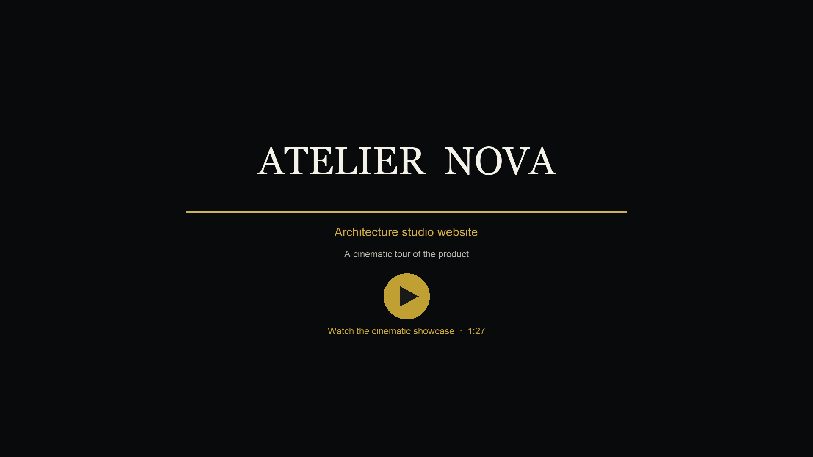
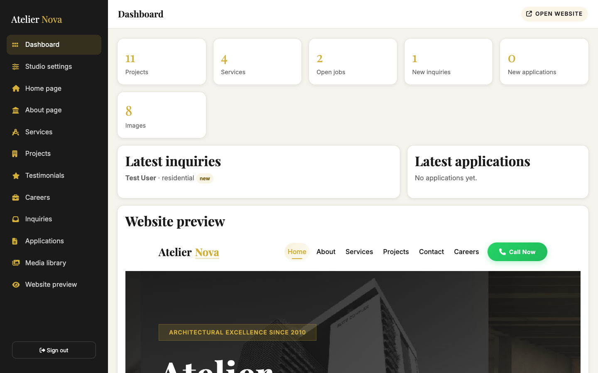
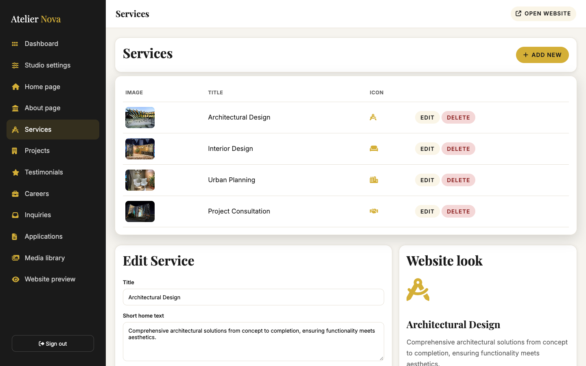
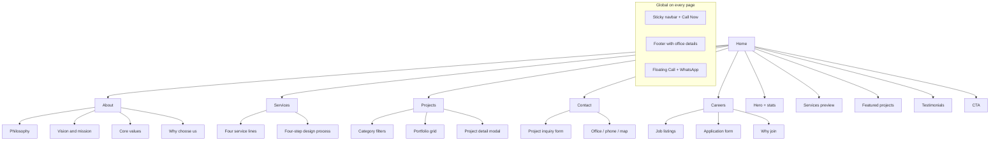

<div align="center">

# Atelier Nova

**Demo architecture studio website**  
HTML • CSS • Bootstrap 5 • JavaScript

**Live:** [https://array-architects.onrender.com](https://array-architects.onrender.com)  
**Showcase video:** [Atelier Nova cinematic tour](assets/tutorial/Atelier-Nova-Cinematic-Showcase.mp4)

</div>

---

## Project overview

**Atelier Nova** is a fictional demo studio used to showcase this frontend. It is not a real client site. The UI covers services, design philosophy, a sample portfolio, and a hiring flow, with placeholder call and WhatsApp actions.

It is a static frontend (no build step) and is suitable as a template for architecture firms, interior studios, and similar portfolio websites.

Demo contact placeholders: `01700-000000`, `hello@ateliernova.demo`, Demo Studio, 12 Example Road, Dhaka. Footer credit: Developed by [Udoy](https://udoyweb.netlify.app/).

---

## Live demo

| Environment | URL |
| --- | --- |
| Production (Render) | [https://array-architects.onrender.com](https://array-architects.onrender.com) |
| Local (XAMPP) | [http://localhost/2026/array-architects/](http://localhost/2026/array-architects/) |
| Source | [github.com/NahimUdoy/array-architects](https://github.com/NahimUdoy/array-architects) |

---

The public URL still uses the existing Render service name (`array-architects.onrender.com`). The on-site brand is Atelier Nova.

---

## Cinematic showcase

Watch the 1:27 product tour — every public page, the admin CMS, and mobile — with original royalty-free music.

<p align="center">
  <a href="assets/tutorial/Atelier-Nova-Cinematic-Showcase.mp4">
    
  </a>
</p>

<p align="center">
  <a href="assets/tutorial/Atelier-Nova-Cinematic-Showcase.mp4"><strong>▶ Play cinematic showcase (MP4)</strong></a>
</p>

---

## Visual overview

Fresh captures from the current Atelier Nova site (desktop 1440×900).

**Desktop**

| Home | About |
| :---: | :---: |
|  |  |
| [Open page](https://array-architects.onrender.com/) | [Open page](https://array-architects.onrender.com/about.html) |

| Services | Projects |
| :---: | :---: |
|  |  |
| [Open page](https://array-architects.onrender.com/services.html) | [Open page](https://array-architects.onrender.com/projects.html) |

| Contact | Careers |
| :---: | :---: |
|  |  |
| [Open page](https://array-architects.onrender.com/contact.html) | [Open page](https://array-architects.onrender.com/careers.html) |

**Admin panel**

| Dashboard | Service editor |
| :---: | :---: |
|  |  |
| [Open admin](http://localhost/2026/array-architects/admin/) | Image upload + live website preview |

**Mobile (Home)**

<p align="center">
  
</p>

**File index**

| File | Page |
| --- | --- |
| `00-showcase-poster.png` | Cinematic video poster |
| `01-home.png` / `01-home-full.png` | Home |
| `02-about.png` / `02-about-full.png` | About |
| `03-services.png` / `03-services-full.png` | Services |
| `04-projects.png` / `04-projects-full.png` | Projects |
| `05-contact.png` / `05-contact-full.png` | Contact |
| `06-careers.png` / `06-careers-full.png` | Careers |
| `07-home-mobile.png` | Home (mobile) |
| `08-admin.png` | Admin dashboard |
| `09-admin-editor.png` | Admin service editor |

---

## Site overview



---

## Feature overview

| Feature | Home | About | Services | Projects | Contact | Careers |
| --- | :---: | :---: | :---: | :---: | :---: | :---: |
| Responsive layout (mobile / tablet / desktop) | Yes | Yes | Yes | Yes | Yes | Yes |
| Sticky navbar + active page state | Yes | Yes | Yes | Yes | Yes | Yes |
| Click-to-call (`+880 1700-000000`) | Yes | Yes | Yes | Yes | Yes | Yes |
| WhatsApp chat (`wa.me/8801700000000`) | Yes | Yes | Yes | Yes | Yes | Yes |
| Floating call / WhatsApp buttons | Yes | Yes | Yes | Yes | Yes | Yes |
| SEO meta tags + semantic HTML | Yes | Yes | Yes | Yes | Yes | Yes |
| Page hero with photography | Yes | Yes | Yes | Yes | Yes | Yes |
| Stats / trust numbers | Yes | Yes | — | — | — | — |
| Services showcase | Preview | — | Full | — | — | — |
| Portfolio / project gallery | Preview | — | — | Full + filters + modal | — | — |
| Testimonials | Yes | — | — | — | — | — |
| Vision, mission, values | — | Yes | — | — | — | — |
| Design process steps | — | — | Yes | — | — | — |
| Project inquiry form + validation | — | — | — | — | Yes | — |
| Google Map embed | — | — | — | — | Yes | — |
| Job listings | — | — | — | — | — | Yes |
| Career application form | — | — | — | — | — | Yes |
| CTA to start a project / apply | Yes | Yes | Yes | Yes | Yes | Yes |

### Shared UI

- Sticky header that changes on scroll
- Mobile hamburger menu (Bootstrap collapse)
- Footer with brand, quick links, contact details, and social icons
- Smooth in-page scrolling that accounts for the sticky nav
- Playfair Display + Inter typography, Font Awesome icons

### Home

- Full-screen hero with overlay, badge, tagline, and dual CTAs
- Trust stats (projects completed, years, satisfaction)
- About teaser
- Four service cards with links through to Services
- Featured project cards
- Client testimonials
- Bottom CTA (quote + call)

### About

- Studio story and philosophy
- Vision and mission
- Core values: Excellence, Innovation, Sustainability, Integrity
- Why-choose-us reasons (track record, team, client focus, delivery)

### Services

- Architectural design
- Interior design
- Urban planning
- Project consultation
- Design process: Consultation → Design Development → Documentation → Construction

### Projects

- Filters: All, Residential, Commercial, Institutional, Interior Design
- Eleven portfolio items with hover overlays
- Click-to-open project modal (image, location, year, area, status, duration, features)
- Modal close via button, overlay click, or Escape
- CTA to start a similar project from the modal

### Contact

- Inquiry form: name, email, phone/WhatsApp, project type, location, budget, description, preferred contact method
- Client-side validation with live field errors
- Office address, phone, email, hours
- Embedded Google Map
- WhatsApp and call shortcuts in the hero

### Careers

- Two job cards (Lumion specialist; architecture & interior architect)
- Apply Now jumps to the application form and pre-fills the role
- Application fields: name, email, phone, role, optional portfolio link, cover message
- Why-join benefits (projects, team, growth, tools, salary, work-life balance)

---

## Tech stack

| Layer | Choice |
| --- | --- |
| Markup | HTML5 |
| Styling | CSS3 + Bootstrap 5 |
| Scripts | Vanilla JavaScript (ES6) |
| Icons / fonts | Font Awesome 6, Google Fonts |
| Hosting | [Render](https://array-architects.onrender.com) static site |
| Version control | Git (GitHub for Render deploys) |

---

## Project structure

```text
array-architects/
├── index.html          Home
├── about.html          About
├── services.html       Services
├── projects.html       Portfolio
├── contact.html        Inquiry form
├── careers.html        Jobs + application
├── admin/              Studio admin panel
├── api/                PHP API for CMS data
├── assets/
│   ├── css/style.css
│   ├── js/main.js
│   ├── js/cms.js
│   ├── images/
│   ├── screenshots/    README captures (current UI + admin)
│   └── tutorial/
│       └── Atelier-Nova-Cinematic-Showcase.mp4
├── render.yaml         Render static-site config
└── README.md
```

---

## Run locally

The site is static. Open it with XAMPP or any local server:

```text
http://localhost/2026/array-architects/
```

Or from this folder:

```bash
python3 -m http.server 8080
```

Then visit `http://localhost:8080`.

---

## Deploy (Render)

Production is a Render static site. Push to `main` on [NahimUdoy/array-architects](https://github.com/NahimUdoy/array-architects) to auto-deploy.

- **Build command:** `true` (no build)
- **Publish directory:** `.`
- **URL:** `https://array-architects.onrender.com`
